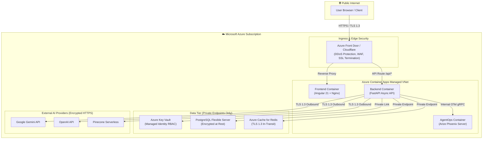

# 🌐 04 - Environment & Configuration Matrix

> **Document ID:** ECM-MOODZ-1.0.0  
> **Status:** Baselined for Staging Verification & Production Cutover  
> **System:** MOODZ AI Mental Wellness Platform  
> **Target Cloud:** Microsoft Azure (Cloud-Native Microservices)  

---

## 1. Purpose & Environment Parity Strategy

This document establishes the official infrastructure specifications, configuration baselines, secrets inventory, and Test Data Management (TDM) rules across all MOODZ operating environments. 

**Environment Parity Principle**: The Staging (Pre-Prod) environment is an identical architectural mirror of Production. No code or configuration is promoted to Production without prior validation in Staging under identical cloud-native constraints (Azure Container Apps, Azure PostgreSQL Flexible Server, Azure Cache for Redis, Azure Key Vault).

---

## 2. Multi-Environment Infrastructure Sizing & Specifications

| Dimension / Resource | Local Development | Staging (Pre-Production) | Production (Go-Live) |
| :--- | :--- | :--- | :--- |
| **Hosting Platform** | Docker Compose / Local Host | Azure Container Apps (ACA) | Azure Container Apps (ACA) |
| **Backend Ingress** | `http://localhost:8000` | `https://staging-api.moodz.internal` | `https://api.moodz.ai` |
| **Frontend Ingress** | `http://localhost:4200` | `https://staging.moodz.internal` | `https://app.moodz.ai` |
| **Backend Compute Tier** | 1 Container (1 vCPU, 2GB RAM) | ACA Consumption (1.0 vCPU, 2.0GB RAM, 1-3 Replicas) | ACA Dedicated/Consumption (2.0 vCPU, 4.0GB RAM, 2-10 Auto-scale Replicas) |
| **Frontend Compute Tier**| Local Angular CLI dev server | ACA Nginx Container (0.5 vCPU, 1GB RAM) | ACA Nginx Container (1.0 vCPU, 2.0GB RAM, Multi-Zone Redundant) |
| **Database (PostgreSQL)**| Local Docker PostgreSQL 16 | Azure Database for PostgreSQL Flexible Server (`Standard_B2s`, 2 vCPU, 4GB RAM) | Azure Database for PostgreSQL Flexible Server (`Standard_D4ds_v5`, 4 vCPU, 16GB RAM, High Availability Zone-Redundant) |
| **Cache (Redis)** | Local Docker Redis 7 | Azure Cache for Redis (`Basic C1`, 1GB) | Azure Cache for Redis (`Standard C2`, 2.5GB, High-Availability Replica) |
| **Vector DB (Pinecone)** | Shared Index / Mock | Dedicated Pinecone Index (`moodz-staging`, Cosine) | Dedicated Production Pinecone Index (`moodz-prod`, Serverless High-Availability) |
| **AgentOps Telemetry** | Local Arize Phoenix (`:6006`) | Azure ACA Phoenix Server (Isolated internal VNet) | Azure ACA Dedicated Phoenix Server with Managed Disk persistence |
| **Secrets Management** | Local `.env` (Untracked) | Azure Key Vault (`kv-moodz-staging`) | Azure Key Vault (`kv-moodz-prod`) with Managed Identity RBAC |
| **TLS / SSL** | Self-signed / Plain HTTP | Managed Azure Certificate (TLS 1.3) | Custom Domain Wildcard SSL (TLS 1.3, Strict-Transport-Security) |

---

## 3. Configuration & Secrets Inventory

All sensitive credentials must be sourced from **Azure Key Vault** using Managed Identities in Staging and Production. Never commit or transmit secrets in plain text.

```
Azure Key Vault Secrets Store:
├── DATABASE_URL                # PostgreSQL connection string with SSL mode require
├── REDIS_URL                   # Redis connection string with rediss:// (TLS)
├── JWT_SECRET_KEY              # Cryptographically secure 256-bit token signing key
├── OPENAI_API_KEY              # API key for OpenAI fallback / evaluation models
├── GEMINI_API_KEY              # API key for Google Gemini 2.5/Flash agent inference
├── PINECONE_API_KEY            # Vector DB key for long-term episodic memory
└── PHOENIX_API_KEY             # Access key for Phoenix AgentOps telemetry ingestion
```

### 3.1 Environment Variable Matrix

| Variable Name | Staging Value / Format | Production Value / Format | Security Sensitivity |
| :--- | :--- | :--- | :--- |
| `ENVIRONMENT` | `staging` | `production` | Low |
| `DEBUG` | `false` | `false` | Low (Must be FALSE in Prod) |
| `DATABASE_URL` | `postgresql+asyncpg://...@psql-moodz-staging...` | `postgresql+asyncpg://...@psql-moodz-prod...` | **High (Key Vault)** |
| `REDIS_URL` | `rediss://:...@redis-moodz-staging.redis.cache.windows.net:6380` | `rediss://:...@redis-moodz-prod.redis.cache.windows.net:6380` | **High (Key Vault)** |
| `JWT_SECRET_KEY` | Managed in Key Vault (Staging Key) | Managed in Key Vault (Production 64-char Hex Key) | **High (Key Vault)** |
| `JWT_ALGORITHM` | `HS256` | `HS256` | Low |
| `ACCESS_TOKEN_EXPIRE_MINUTES`| `60` | `15` (Shorter TTL in Production) | Medium |
| `PINECONE_INDEX_NAME` | `moodz-staging` | `moodz-prod` | Medium |
| `PINECONE_ENVIRONMENT` | `us-east-1` | `us-east-1` | Low |
| `CRISIS_GATE_STRICT_MODE` | `true` | `true` | **Critical (Must be TRUE)** |
| `ENABLE_PII_SCRUBBING` | `true` | `true` | **Critical (Must be TRUE)** |
| `PHOENIX_COLLECTOR_ENDPOINT` | `http://phoenix-staging.internal:4317` | `http://phoenix-prod.internal:4317` | Medium |
| `CORS_ORIGINS` | `https://staging.moodz.internal` | `https://app.moodz.ai,https://moodz.ai` | High (Strict Origin Lock) |

---

## 4. Network Security & Cloud Architecture



---

## 5. Test Data Management (TDM) Plan

In compliance with patient confidentiality and HIPAA/GDPR best practices:

1. **Absolute Prohibition of Real User Data**: Real patient or beta-user conversations must **never** be copied into Staging or QA databases.
2. **Synthetic Data Seeding**:
   * Synthetic user personas (e.g., Student with exam stress, Professional with burnout, Caregiver with grief) are generated using randomized, synthetic datasets.
   * Seeding is executed via automated scripts (`backend/test/seed_test_data.py`).
3. **Database Cleansing & Tear-Down**:
   * Staging databases are scrubbed and re-seeded after each major test cycle.
   * Redis keys are namespaced with prefixes (`moodz:staging:session:*`) and carry an automated 24-hour expiration policy.
4. **Pinecone Vector Namespace Segregation**:
   * Vector records in Pinecone are strictly tagged with `user_id` metadata and stored in the dedicated `moodz-staging` index, eliminating any cross-environment data contamination.
