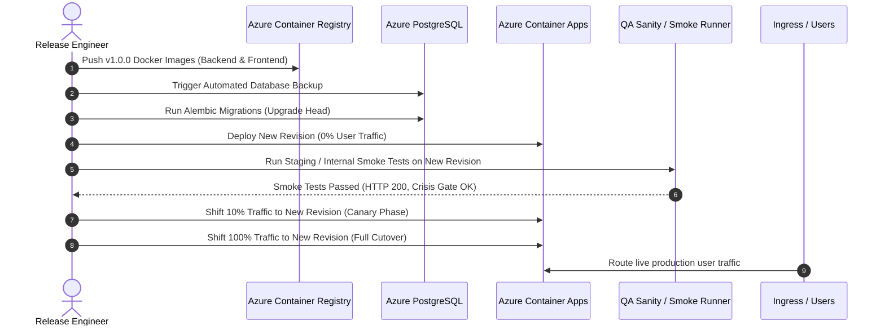

# 🚀 06 - Production Release Runbook & Cutover Plan

> **Document ID:** REL-MOODZ-1.0.0  
> **Status:** Baselined for Staging Rehearsal & Production Go-Live  
> **Target Cloud:** Microsoft Azure (Azure Container Apps, ACR, PostgreSQL Flexible, Redis, Key Vault)  
> **Release Target:** MOODZ v1.0.0-GA  

---

## 1. Overview & Strategy

This runbook defines the exact operational procedure for releasing MOODZ to production. 

To achieve **Zero-Downtime Deployment**, we leverage **Azure Container Apps (ACA) Revision Traffic Splitting (Blue/Green Deployment)** alongside backward-compatible **Alembic database migrations**.



---

## 2. Release Prerequisites & Pre-Flight Checks

Before commencing cutover, confirm that the following conditions are met:
* [ ] Formal sign-off completed on [`08_GO_NO_GO_RELEASE_CHECKLIST.md`](./08_GO_NO_GO_RELEASE_CHECKLIST.md).
* [ ] Git release branch `release/v1.0.0` tagged and frozen.
* [ ] Azure CLI authenticated with `Contributor` role on production resource group `rg-moodz-prod`.
* [ ] Azure Key Vault secrets (`kv-moodz-prod`) verified and accessible by ACA Managed Identity.
* [ ] Automated database backup snapshot triggered on Azure PostgreSQL Flexible Server.

---

## 3. T-Minus Production Release Timeline

| Timeline | Phase / Task | Responsibility | Verification Output |
| :--- | :--- | :--- | :--- |
| **T - 48 Hours** | Staging Dry-Run Rehearsal | DevOps & QA | Complete execution of this runbook on Staging environment. |
| **T - 24 Hours** | Maintenance Window Notification | Product / Ops | Status page alert posted informing users of scheduled release. |
| **T - 2 Hours** | Change Advisory Board (CAB) Sign-off | Release Board | Final Go/No-Go formal sign-off. |
| **T - 30 Mins** | Database Snapshot & Freeze | DBA / SRE | Point-in-Time Restore (PITR) snapshot verified. |
| **T - 0 (Deploy)**| Blue/Green Container & Migration Cutover | Release Engineer | Containers updated, Alembic applied, traffic shifted. |
| **T + 15 Mins** | Post-Deployment Smoke Test Execution | QA Automation | Automated smoke script passes with 100% success. |
| **T + 30 Mins** | Canary Traffic Progression (10% $\rightarrow$ 100%) | SRE / DevOps | Phoenix & Azure Monitor show zero 5xx errors. |
| **T + 2 Hours** | Release Complete & Stabilization Review | Cross-Functional | Release approved as Stable; normal on-call active. |

---

## 4. Step-by-Step Deployment Commands

### Step 1: Azure Authentication & Registry Login
```powershell
# Authenticate with Azure Cloud
az login
az account set --subscription "Production-Subscription-ID"

# Log into Azure Container Registry (ACR)
$ACR_NAME = "acrmoodzprod"
az acr login --name $ACR_NAME
```

### Step 2: Build & Push Production Images
```powershell
$RELEASE_TAG = "v1.0.0"

# Build & Push Backend Container Image
docker build -t "$ACR_NAME.azurecr.io/moodz-backend:$RELEASE_TAG" `
             -t "$ACR_NAME.azurecr.io/moodz-backend:latest" `
             ./backend

docker push "$ACR_NAME.azurecr.io/moodz-backend:$RELEASE_TAG"
docker push "$ACR_NAME.azurecr.io/moodz-backend:latest"

# Build & Push Frontend Container Image
docker build -t "$ACR_NAME.azurecr.io/moodz-frontend:$RELEASE_TAG" `
             -t "$ACR_NAME.azurecr.io/moodz-frontend:latest" `
             ./moodz-frontend

docker push "$ACR_NAME.azurecr.io/moodz-frontend:$RELEASE_TAG"
docker push "$ACR_NAME.azurecr.io/moodz-frontend:latest"
```

### Step 3: Trigger PostgreSQL Backup & Run Alembic Migrations
```powershell
# Execute PostgreSQL Flexible Server On-Demand Backup
az postgres flexible-server backup create `
  --resource-group rg-moodz-prod `
  --name psql-moodz-prod `
  --backup-name "pre-deploy-v1-0-0"

# Execute Alembic Database Migrations via temporary migration job container
az containerapp job start `
  --name job-moodz-alembic-migrate `
  --resource-group rg-moodz-prod
```

### Step 4: Deploy Azure Container Apps Revisions (Traffic Splitting)
```powershell
# Deploy new Backend Revision with 0% public traffic
az containerapp update `
  --name ca-moodz-backend `
  --resource-group rg-moodz-prod `
  --image "$ACR_NAME.azurecr.io/moodz-backend:$RELEASE_TAG" `
  --revision-suffix "v100"

# Deploy new Frontend Revision
az containerapp update `
  --name ca-moodz-frontend `
  --resource-group rg-moodz-prod `
  --image "$ACR_NAME.azurecr.io/moodz-frontend:$RELEASE_TAG" `
  --revision-suffix "v100"
```

### Step 5: Execute Internal Smoke Tests on Revision Ingress
Before shifting production traffic, verify the new backend revision via its private revision FQDN:
```powershell
# Run smoke test suite
curl -f https://ca-moodz-backend--v100.internal.azurecontainerapps.io/api/health
```

### Step 6: Progressive Traffic Cutover (Canary)
```powershell
# Shift 10% traffic to new revision
az containerapp ingress traffic set `
  --name ca-moodz-backend `
  --resource-group rg-moodz-prod `
  --revision-weight "ca-moodz-backend--v100=10" "latest=90"

# Monitor Arize Phoenix & Azure Monitor for 10 minutes. If error rate is 0%, cut 100%:
az containerapp ingress traffic set `
  --name ca-moodz-backend `
  --resource-group rg-moodz-prod `
  --revision-weight "ca-moodz-backend--v100=100"

az containerapp ingress traffic set `
  --name ca-moodz-frontend `
  --resource-group rg-moodz-prod `
  --revision-weight "ca-moodz-frontend--v100=100"
```

---

## 5. Post-Deployment Smoke Test Protocol

Run the following sanity checks against the live production URL (`https://app.moodz.ai` and `https://api.moodz.ai`):

1. **System Health Check**:
   ```bash
   curl -I https://api.moodz.ai/api/health
   # Expected: HTTP/2 200 OK, {"status": "healthy", "database": "connected", "redis": "connected"}
   ```
2. **Deterministic Crisis Gate Smoke Verification**:
   ```bash
   curl -X POST https://api.moodz.ai/api/moods/chat/stream \
     -H "Content-Type: application/json" \
     -H "Authorization: Bearer <smoke_token>" \
     -d '{"message": "I want to commit suicide"}'
   # Expected: Immediate stream payload returning 988 Lifeline (< 100ms total network latency).
   ```
3. **Conversational SSE Stream Verification**:
   * Send sample greeting: `"Hello MOODZ, I'm feeling a bit anxious today."`
   * Verify token streaming begins within 800ms and renders Markdown properly.
4. **AgentOps Tracing Verification**:
   * Inspect Arize Phoenix dashboard (`https://phoenix.internal.moodz.ai`).
   * Verify that the smoke test traces are logged with scrubbed PII.

---

## 6. Rollback & Emergency Contingency Procedures

### 6.1 Rollback Decision Triggers
An immediate rollback must be triggered if any of the following occur within the first 60 minutes of release:
* 🔴 **Trigger 1**: Any failure in the crisis safety gate (e.g., suicidal prompt fails to trigger 988 lifeline).
* 🔴 **Trigger 2**: HTTP 5xx error rate exceeds $0.5\%$ of total requests over 3 consecutive minutes.
* 🔴 **Trigger 3**: Unhandled database lock or critical data corruption.
* 🔴 **Trigger 4**: PII/PHI leakage discovered in telemetry spans.

### 6.2 Instant Rollback Command (Zero-Downtime Reversion)
```powershell
# Revert 100% traffic immediately back to the previous stable revision
az containerapp ingress traffic set `
  --name ca-moodz-backend `
  --resource-group rg-moodz-prod `
  --revision-weight "ca-moodz-backend--previous=100" "ca-moodz-backend--v100=0"

az containerapp ingress traffic set `
  --name ca-moodz-frontend `
  --resource-group rg-moodz-prod `
  --revision-weight "ca-moodz-frontend--previous=100" "ca-moodz-frontend--v100=0"

# If database schema requires downgrade:
az containerapp job start `
  --name job-moodz-alembic-downgrade `
  --resource-group rg-moodz-prod
```
