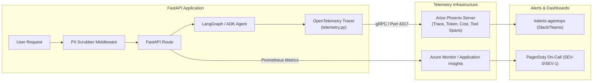

# 📈 07 - Production Observability, SLA & Incident Playbook

> **Document ID:** OPS-MOODZ-1.0.0  
> **Status:** Operational Baseline for Production Go-Live  
> **System:** MOODZ AI Mental Wellness Platform  
> **AgentOps Platform:** Arize Phoenix v4.x & OpenTelemetry Collector  

---

## 1. Overview & Operational Philosophy

Once MOODZ is deployed to production, system reliability and clinical safety require continuous monitoring and immediate incident response capabilities. 

This playbook defines:
1. Service Level Agreements (SLAs) and Service Level Objectives (SLOs).
2. Arize Phoenix telemetry dashboards and OpenTelemetry metric baselines.
3. Automated alerting thresholds.
4. Incident severity classifications and on-call escalation procedures.
5. Standard Operating Procedures (SOPs) for remediating common production failure modes.

---

## 2. Service Level Objectives (SLOs) & Indicators (SLIs)

| Service Dimension | Service Level Indicator (SLI) | Target SLO | Production SLA (Customer Facing) |
| :--- | :--- | :--- | :--- |
| **System Availability** | Percentage of successful HTTP requests (`2xx`/`3xx` over total) | **$\ge 99.95\%$** uptime | **$\ge 99.9\%$** uptime |
| **Crisis Detection Latency** | Time taken by `CrisisDetector` regex heuristics to flag emergency | **P99 $\le 10\text{ ms}$** | **P99 $\le 20\text{ ms}$** |
| **Time-to-First-Token (TTFT)** | Elapsed time from user submit until first SSE chunk rendered | **P95 $\le 800\text{ ms}$** | **P95 $\le 1500\text{ ms}$** |
| **Streaming Throughput** | Output token generation speed per user | **$\ge 25\text{ tokens/sec}$** | **$\ge 15\text{ tokens/sec}$** |
| **PII Redaction Efficacy** | Percentage of sensitive identifiers scrubbed before telemetry | **$100.0\%$ (Zero leaks)** | **$100.0\%$** |
| **Empathy Quality Baseline** | DeepEval LLM-as-a-judge empathy score on sampled live chats | **$\ge 0.85 / 1.00$** | **$\ge 0.80 / 1.00$** |
| **Database Query Latency** | P95 latency for PostgreSQL user mood analytics queries | **P95 $\le 50\text{ ms}$** | **P95 $\le 100\text{ ms}$** |

---

## 3. Observability Architecture (Arize Phoenix & OpenTelemetry)



### 3.1 Primary Operational Dashboards
* **Phoenix AgentOps Dashboard** (`https://phoenix.internal.moodz.ai`):
  * Multi-step Agent Trace Waterfall (StateGraph transitions, ADK tool calls).
  * Token spend and financial cost per model provider (Gemini 2.5 Flash vs. GPT-4).
  * Latency distribution (TTFT and total generation duration).
  * Human-in-the-Loop (HITL) thumbs up/down rating ratio and user qualitative comments.
* **Azure Monitor / Container Apps Dashboard**:
  * Active replica counts, CPU utilization, memory consumption, HTTP 4xx/5xx error rates, Redis memory saturation.

---

## 4. Production Alerting Thresholds

| Alert Name | Condition & Metric | Evaluation Window | Severity | Escalation Channel |
| :--- | :--- | :--- | :--- | :--- |
| **CRISIS_DETECTOR_LATENCY_SPIKE** | Crisis check execution $> 25\text{ms}$ | 1 minute | **SEV-1** | PagerDuty + Slack `#alerts-safety` |
| **HIGH_5XX_ERROR_RATE** | HTTP 5xx responses $> 1.0\%$ | 3 minutes | **SEV-1** | PagerDuty On-Call |
| **LLM_PROVIDER_RATE_LIMIT** | Third-party AI provider returns HTTP 429 | 1 minute | **SEV-2** | Slack `#alerts-agentops` |
| **REDIS_MEMORY_CRITICAL** | Redis memory utilization $> 85\%$ | 5 minutes | **SEV-2** | DevOps On-Call |
| **PINECONE_TIMEOUT_RATE** | Vector memory query timeout $> 5\%$ | 5 minutes | **SEV-2** | AI Engineering On-Call |
| **LOW_EMPATHY_RATING_SURGE** | Negative HITL thumbs-down $> 15\%$ | 1 hour | **SEV-3** | Clinical & Product Review |

---

## 5. Incident Severity Classification & On-Call Playbook

### 5.1 Severity Levels
* **SEV-0 (Catastrophic)**: Crisis safety gate failure (suicidal intent not intercepted) or active data breach/PII leak.
  * *Response SLA*: Immediate acknowledgment ($< 5\text{ minutes}$); Executive Incident Command activated.
* **SEV-1 (Critical)**: Production outage; chat streaming completely unavailable for all users.
  * *Response SLA*: $< 15\text{ minutes}$.
* **SEV-2 (Major)**: Partial degradation; vector memory degraded, or high latency (TTFT $> 3\text{ seconds}$).
  * *Response SLA*: $< 1\text{ hour}$.
* **SEV-3 (Minor)**: Non-blocking cosmetic bugs, minor telemetry export delays.
  * *Response SLA*: Next business day.

---

## 6. Standard Operating Procedures (SOPs) for Production Incidents

### SOP-01: Third-Party LLM Outage or Rate Limit (Gemini / OpenAI 429 or 503)
1. **Diagnosis**: Azure Monitor and Phoenix report surge in HTTP 429 or 503 errors from external LLM endpoints.
2. **Mitigation**:
   * Inspect automated fallback logs in `app/services/fallback_mocks.py`.
   * Enable multi-provider fallback in Azure Key Vault / App Config:
     ```bash
     # Switch active LLM provider from Gemini to OpenAI (or fallback graceful companion mode)
     az containerapp update --name ca-moodz-backend --resource-group rg-moodz-prod `
       --set-env-vars LLM_FALLBACK_MODE="enabled"
     ```
   * Confirm system begins serving graceful, empathetic supportive responses while alerting users of temporary AI provider congestion.

### SOP-02: Pinecone Vector Database Latency Spike or Unavailability
1. **Diagnosis**: Pinecone vector searches exceed 500ms or throw timeout exceptions.
2. **Mitigation**:
   * The `VectorService` is architected with graceful degradation. If Pinecone fails, the system logs a warning and proceeds with short-term Redis context only.
   * Verify that chat sessions continue uninterrupted without user-facing 500 errors.
   * If timeouts persist, toggle `ENABLE_EPISODIC_MEMORY="false"` temporarily until Pinecone serverless status returns to normal.

### SOP-03: Sudden Redis Cache Saturation
1. **Diagnosis**: Redis memory alert triggers at $> 85\%$.
2. **Mitigation**:
   * Connect to Azure Cache for Redis console.
   * Execute `INFO memory` to inspect key distribution.
   * Trigger cleanup of expired conversation buffer keys or scale up Redis SKU from Standard C2 to Standard C3.

---

## 7. Blameless Post-Mortem Incident Template

Any SEV-0 or SEV-1 incident requires a documented Post-Mortem within 48 hours of resolution:
* **Incident Summary**: What happened, when, and who was impacted.
* **Root Cause Analysis (5 Whys)**: The technical and procedural factors that led to the event.
* **Timeline of Events**: Chronological breakdown from detection to resolution.
* **Corrective & Preventative Action Items**: Specific GitHub issues assigned with due dates to prevent recurrence.
