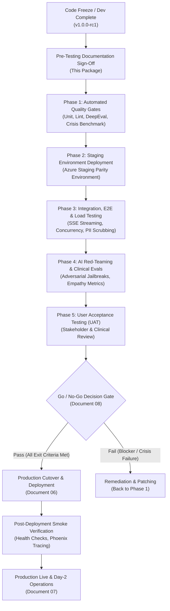

# 📋 MOODZ Pre-Testing & Production Release Documentation Package

> **Status:** Code Complete / Feature Freeze  
> **Next Milestone:** Formal Pre-Production Testing & QA Verification  
> **Target Milestone:** Production Go-Live (Microsoft Azure Cloud-Native)  
> **System:** MOODZ AI Mental Wellness Companion  
> **Version:** 1.0.0-rc1  
> **Date:** October 2026  

---

## 🏛️ Executive Summary

In enterprise software engineering—especially within **AI-driven Digital Health and Mental Wellness SaaS**—the transition from **Development Complete** to **Production Release** is strictly governed. Before testing begins, organizations establish a comprehensive documentation and assurance baseline. This ensures that:
1. **Verification is deterministic and measurable**: QA, AI Engineers, and Clinical Safety reviewers evaluate against clear, auditable criteria rather than informal checks.
2. **Production deployment is rehearsed and zero-risk**: Database migrations, rollback strategies, DNS cutovers, and Azure infrastructure configurations are validated in Staging prior to live production deployment.
3. **Regulatory, Ethical, and Safety Standards are met**: Crucial protections (100% recall on crisis/self-harm triggers, deterministic fallback to 988 Suicide & Crisis Lifeline, and sub-millisecond PII/PHI sanitization) are formally verified.

This directory (`docs/release-readiness/`) contains the complete enterprise documentation suite created at the conclusion of development to guide the testing phase and govern final production release.

---

## 📂 Document Suite Map

| Document | File Name | Primary Owner | Description & Industry Purpose |
| :--- | :--- | :--- | :--- |
| **01** | [`01_MASTER_TEST_PLAN.md`](./01_MASTER_TEST_PLAN.md) | QA Lead / AI Lead | Master Test Plan (IEEE 829 / ISO 29119 compliant). Defines test levels, AI-as-a-judge empathy thresholds, crisis safety gates, performance benchmarks, and production entry/exit criteria. |
| **02** | [`02_REQUIREMENTS_TRACEABILITY_MATRIX.md`](./02_REQUIREMENTS_TRACEABILITY_MATRIX.md) | Business Analyst / QA | Requirements Traceability Matrix (RTM). Maps functional, clinical safety, and non-functional requirements directly to code modules, test cases, and release acceptance gates. |
| **03** | [`03_TEST_CASE_SPECIFICATION.md`](./03_TEST_CASE_SPECIFICATION.md) | QA Engineering | Comprehensive test case catalog. Contains explicit test steps, test inputs, expected results, and automated test bindings (Pytest, DeepEval, Karma/Jasmine). |
| **04** | [`04_ENVIRONMENT_AND_CONFIGURATION_MATRIX.md`](./04_ENVIRONMENT_AND_CONFIGURATION_MATRIX.md) | DevOps / SRE | Environment parity matrix (Local Dev vs. Staging vs. Production). Details infrastructure specifications, Azure Key Vault secrets, network isolation, and test data management. |
| **05** | [`05_AI_SAFETY_ETHICS_AND_CLINICAL_GOVERNANCE.md`](./05_AI_SAFETY_ETHICS_AND_CLINICAL_GOVERNANCE.md) | AI Safety Officer / Clinical Advisor | Clinical safety & AI ethics protocol. Covers deterministic 988 emergency escalation, clinical disclaimer guardrails, prompt injection / red-teaming defenses, and HIPAA/GDPR PII sanitization. |
| **06** | [`06_PRODUCTION_RELEASE_RUNBOOK.md`](./06_PRODUCTION_RELEASE_RUNBOOK.md) | Release Manager / DevOps | Production cutover and deployment runbook. Step-by-step T-minus deployment schedule, Alembic zero-downtime DB migrations, Azure Container Apps traffic shifting, smoke tests, and rollback triggers. |
| **07** | [`07_OBSERVABILITY_SLA_AND_INCIDENT_PLAYBOOK.md`](./07_OBSERVABILITY_SLA_AND_INCIDENT_PLAYBOOK.md) | SRE Lead / On-Call Team | Service Level Agreements (SLAs), Arize Phoenix telemetry dashboards, OpenTelemetry metrics, alerting thresholds, on-call escalation matrix, and incident response playbooks. |
| **08** | [`08_GO_NO_GO_RELEASE_CHECKLIST.md`](./08_GO_NO_GO_RELEASE_CHECKLIST.md) | Cross-Functional Release Board | Formal sign-off and gate certification document. Requires explicit sign-offs from Engineering, QA, DevOps, Security, and Product before the production release can proceed. |

---

## 🔄 Release Lifecycle Stage-Gate Workflow

---

## 👥 Stakeholder Sign-Off Matrix

Before proceeding from Testing to Production Release, the following team leads must formally execute the Stage-Gate Sign-Off defined in [`08_GO_NO_GO_RELEASE_CHECKLIST.md`](./08_GO_NO_GO_RELEASE_CHECKLIST.md):

* **Engineering Lead**: Confirms code freeze, unit test coverage, and build artifact integrity.
* **QA / Test Automation Lead**: Confirms all test cases executed, zero P0/P1 defects, and regression passes.
* **AI Safety & Alignment Lead**: Confirms 100% recall on crisis safety benchmarks and DeepEval empathy scores.
* **DevOps / Cloud Architect**: Confirms Azure infrastructure provisioning, secrets configuration, and rollback readiness.
* **Product / Clinical Compliance Lead**: Confirms non-clinical compliance disclaimers and user acceptance sign-off.
